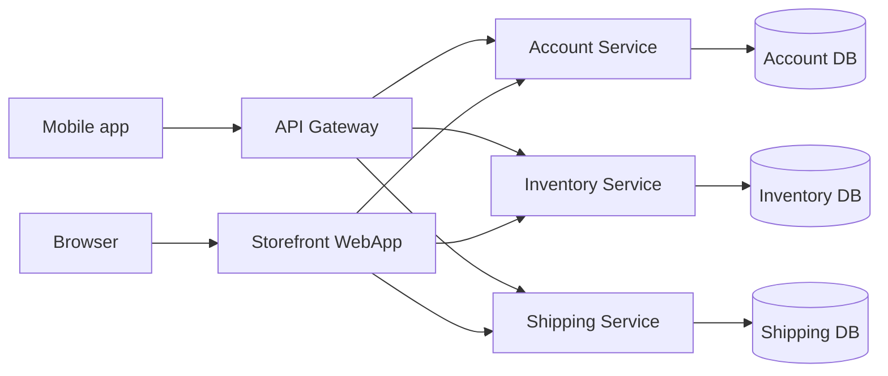
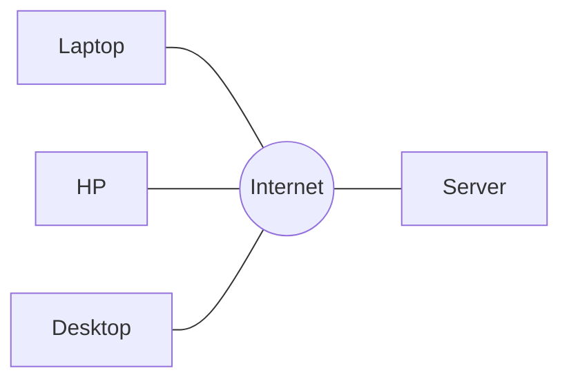
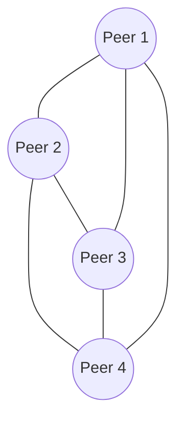
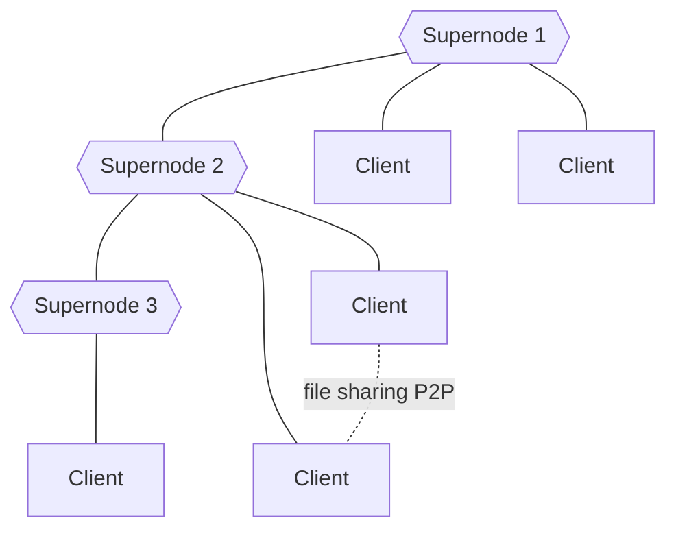
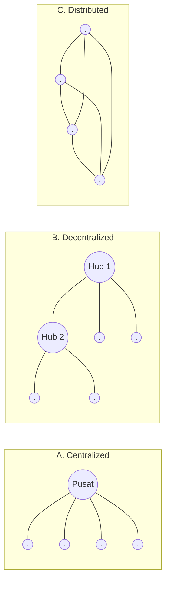
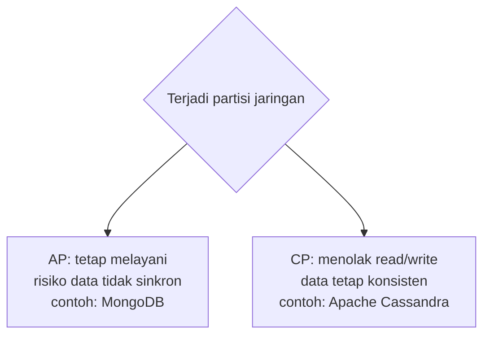

# 01 — Pengenalan Sistem Terdistribusi dan Terdesentralisasi

> **Mata kuliah:** Sistem Terdistribusi dan Terdesentralisasi (FIF25002T, 3 SKS) · Prodi Informatika · UTDI
> **Dosen:** Dr. Bambang Purnomosidi D. P.

## Daftar Isi
1. [Mengapa penting?](#1-mengapa-penting)
2. [Sistem terdistribusi](#2-sistem-terdistribusi)
3. [Arsitektur dasar](#3-arsitektur-dasar)
4. [Karakteristik](#4-karakteristik-sistem-terdistribusi)
5. [Sistem terdesentralisasi](#5-sistem-terdesentralisasi)
6. [Terdistribusi vs terdesentralisasi](#6-terdistribusi-vs-terdesentralisasi)
7. [Studi kasus](#7-studi-kasus)
8. [CAP Theorem](#8-cap-theorem-eric-brewer-2000)
9. [Konsistensi data](#9-konsistensi-data)
10. [Tantangan & tren](#10-tantangan-dan-tren-masa-depan)
11. [Ringkasan](#11-ringkasan)

---

## 1. Mengapa penting?
- Data dan pengguna tumbuh sangat besar → butuh **skalabilitas**.
- Layanan harus **fault-tolerant** dan tersedia **24/7**.
- Tanpa sistem terdistribusi/terdesentralisasi, Google, Netflix, dan Blockchain tidak mungkin ada.

| Istilah | Arti |
|---|---|
| **Skalabilitas** | Kemampuan menangani peningkatan beban/pengguna tanpa menurunkan kinerja. |
| **Fault-tolerant** | Tetap beroperasi normal walau sebagian komponen (hardware/software) gagal. |

## 2. Sistem terdistribusi
> *"A collection of independent computers that appears to its users as a single coherent system."*
> — Tanenbaum & van Steen (2007)

Tiga ciri utama: **komponen independen**, **berkomunikasi lewat jaringan**, dan **transparan** (lokasi, akses, replikasi, kegagalan tidak terlihat oleh pengguna).

*Contoh toko online: pengguna merasa memakai satu aplikasi, padahal di belakangnya ada banyak service dan database terpisah.*

## 3. Arsitektur dasar

### a. Client–Server
Banyak client mengakses satu server pusat lewat internet.

### b. Peer-to-Peer (P2P)
Semua node setara; saling terhubung langsung tanpa server pusat. Contoh: **BitTorrent**, **Bitcoin**, **Ethereum**.

### c. Hybrid
Campuran: client terhubung ke **supernode**, antar supernode saling terhubung, file-sharing bisa langsung peer-to-peer. Contoh: **WhatsApp, Signal, Telegram**.

| Arsitektur | Kontrol | Titik lemah | Contoh |
|---|---|---|---|
| Client–Server | Terpusat | Server = single point of failure | Web biasa |
| P2P | Merata | Koordinasi lebih rumit | BitTorrent, Bitcoin |
| Hybrid | Sebagian | Supernode jadi titik penting | WhatsApp, Telegram |

## 4. Karakteristik sistem terdistribusi
-  Transparansi lokasi
-  Skalabilitas
-  Fault tolerance
-  Kinerja tinggi
-  Heterogenitas (beragam perangkat/OS/jaringan)

## 5. Sistem terdesentralisasi
- **Sentralisasi:** 1 titik kontrol.
- **Desentralisasi:** kontrol didistribusikan, **tidak ada single point of failure**.
- Keputusan diambil secara kolektif lewat **konsensus**.
- Contoh: **Blockchain, DNS, BitTorrent**.

Tiga topologi jaringan menurut **Paul Baran (1964)**:

## 6. Terdistribusi vs terdesentralisasi

| Aspek | Terdistribusi | Terdesentralisasi |
|---|---|---|
| **Fokus** | Pembagian **beban kerja** | Pembagian **kontrol** |
| **Contoh** | Google File System, MinIO Object Storage (kini di-fork ke Silo) | Blockchain |

>  **Ringkas:** terdistribusi = berbagi *pekerjaan*; terdesentralisasi = berbagi *kekuasaan*. Keduanya terkait tetapi fokusnya berbeda.

## 7. Studi kasus

| Terdistribusi | Terdesentralisasi |
|---|---|
| Google File System / HDFS → penyimpanan data besar | Blockchain (Bitcoin, Ethereum, Algorand, Sui, Near, Aptos, …) |
| Apache Kafka, Apache Pulsar → messaging & streaming | DNS (Domain Name System) |
| Netflix, Twitch, YouTube | BitTorrent |
| Instagram, Threads, Facebook, TikTok | |

## 8. CAP Theorem (Eric Brewer, 2000)

| Huruf | Arti |
|---|---|
| **C** — Consistency | Setiap baca mengembalikan tulisan terbaru, atau error. |
| **A** — Availability | Setiap permintaan ke node yang tidak gagal mendapat respons non-error (walau bukan data terbaru). |
| **P** — Partition Tolerance | Sistem tetap jalan walau komunikasi antar node terputus/terfragmentasi. |

Pada distributed data store, partisi **pasti** bisa terjadi, sehingga saat partisi kita harus memilih:

*(Catatan: pengelompokan MongoDB sebagai AP dan Cassandra sebagai CP mengikuti slide dosen.)*

## 9. Konsistensi data

| Model | Arti | Contoh |
|---|---|---|
| **Strong** | Hasil selalu sama di semua node | Bank |
| **Eventual** | Lama-lama konsisten | Media sosial |

## 10. Tantangan dan tren masa depan

**Tantangan**
- **Latency** (seberapa lama diproses) & **throughput** (seberapa banyak diproses)
- **Keamanan:** DDoS, **Sybil attack**
- Kompleksitas manajemen node
- **Governance** (tata kelola) pada sistem terdesentralisasi

> **Sybil attack:** penyerang membuat banyak identitas palsu (akun/node, bisa ribuan) untuk mendominasi pengaruh, suara, atau reputasi di jaringan. Umum pada P2P dan blockchain. Nama berasal dari buku tahun 1973 tentang seorang perempuan dengan *identity disorder*.

**Tren:** Cloud-native (Kubernetes, Docker) · Edge & Fog Computing · Web3 & DeFi · Federated Learning (AI terdistribusi)

## 11. Ringkasan
- Sistem terdistribusi = **berbagi beban kerja**.
- Sistem terdesentralisasi = **berbagi kontrol**.
- Keduanya saling terkait tapi berbeda fokus, dan menjadi fondasi teknologi modern.

###  Bahan diskusi
1. Mengapa dunia semakin bergerak menuju distribusi dan desentralisasi?
2. Contoh sehari-hari mana yang paling terasa bagi Anda?