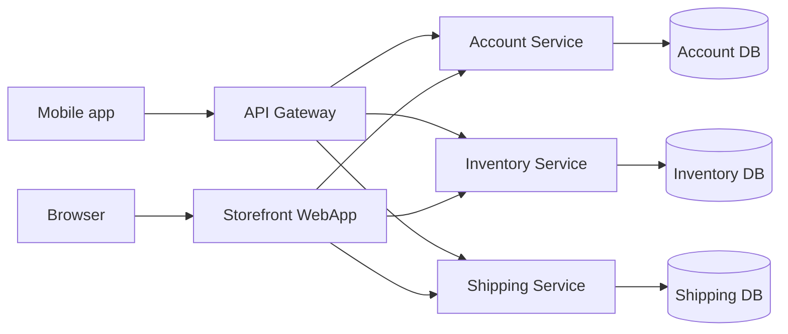

FROM
┌─────────────────────────────────────────────┐
│              FORM RANGKUMAN                 │
├─────────────────────────────────────────────┤
│                                             │
│  Judul       : ___________________________  │
│                                             │
│  Mata Kuliah : ___________________________  │
│                                             │
│  Kode        : ___________________________  │
│                                             │
│  SKS         : ___________________________  │
│                                             │
│  Prodi       : ___________________________  │
│                                             │
│  Institusi   : UTDI                         │
│                                             │
│  Dosen       : Dr. Bambang Purnomosidi D.P. │
│                                             │
│  Minggu      : 4                            │
│                                             │
│  Topik       : ___________________________  │
│                ___________________________  │
│                ___________________________  │
│                                             │
└─────────────────────────────────────────────┘

# Minggu 01 — Pengenalan Sistem Terdistribusi dan Terdesentralisasi

## Tujuan Pembelajaran
- Menjelaskan konsep **sistem terdistribusi**.
- Menjelaskan konsep **sistem terdesentralisasi**.
- Menjelaskan **perbedaan** keduanya.
- Menyebutkan contoh penerapan nyata keduanya.
- Menyebutkan **tantangan dan tren** terbaru.

## Konsep Utama & Penjelasan

### 1. Mengapa penting?
- Data dan pengguna tumbuh sangat besar, sehingga dibutuhkan **skalabilitas**.
- Layanan harus **fault-tolerant** dan tersedia **24/7**.
- Tanpa kedua jenis sistem ini, Google, Netflix, dan Blockchain tidak mungkin ada.

### 2. Sistem terdistribusi
> *"A collection of independent computers that appears to its users as a single coherent system."* — Tanenbaum & van Steen (2007)

Tiga ciri utama:
- **Komponen independen**
- **Berkomunikasi lewat jaringan**
- **Transparan**: lokasi, akses, replikasi, dan kegagalan tidak terlihat oleh pengguna.

### 3. Arsitektur dasar
| Arsitektur | Kontrol | Titik lemah | Contoh |
|---|---|---|---|
| **Client–Server** | Terpusat | Server = *single point of failure* | Web biasa |
| **Peer-to-Peer (P2P)** | Merata | Koordinasi lebih rumit | BitTorrent, Bitcoin, Ethereum |
| **Hybrid** | Sebagian | Supernode jadi titik penting | WhatsApp, Signal, Telegram |

### 4. Karakteristik sistem terdistribusi
Transparansi lokasi · Skalabilitas · Fault tolerance · Kinerja tinggi · Heterogenitas (beragam perangkat/OS/jaringan).

### 5. Sistem terdesentralisasi
- **Sentralisasi**: satu titik kontrol.
- **Desentralisasi**: kontrol didistribusikan, **tidak ada single point of failure**.
- Keputusan diambil kolektif lewat **konsensus**.
- Contoh: **Blockchain, DNS, BitTorrent**.
- Tiga topologi menurut **Paul Baran (1964)**: *Centralized*, *Decentralized*, *Distributed*.

### 6. Terdistribusi vs terdesentralisasi
| Aspek | Terdistribusi | Terdesentralisasi |
|---|---|---|
| **Fokus** | Pembagian **beban kerja** | Pembagian **kontrol** |
| **Contoh** | Google File System, MinIO (kini di-fork ke Silo) | Blockchain |

### 7. CAP Theorem (Eric Brewer, 2000)
- **C — Consistency**: setiap baca mengembalikan tulisan terbaru, atau error.
- **A — Availability**: setiap permintaan ke node yang tidak gagal mendapat respons non-error (walau bukan data terbaru).
- **P — Partition Tolerance**: sistem tetap jalan walau komunikasi antar node terputus.

Partisi **pasti** bisa terjadi, sehingga saat partisi perancang memilih:
- **AP**: tetap melayani, risiko data tidak sinkron (contoh di slide: MongoDB).
- **CP**: menolak read/write demi konsistensi (contoh di slide: Apache Cassandra).

> Catatan: pengelompokan MongoDB sebagai AP dan Cassandra sebagai CP mengikuti slide dosen.

### 8. Konsistensi data
| Model | Arti | Contoh |
|---|---|---|
| **Strong** | Hasil selalu sama di semua node | Bank |
| **Eventual** | Lama-lama konsisten | Media sosial |

### 9. Tantangan dan tren
- **Tantangan**: latency & throughput, keamanan (DDoS, **Sybil attack**), kompleksitas manajemen node, **governance** pada sistem terdesentralisasi.
- **Sybil attack**: penyerang membuat banyak identitas palsu untuk mendominasi pengaruh, suara, atau reputasi di jaringan (umum di P2P dan blockchain).
- **Tren**: Cloud-native (Kubernetes, Docker), Edge & Fog Computing, Web3 & DeFi, Federated Learning.

## Contoh / Studi Kasus
| Terdistribusi | Terdesentralisasi |
|---|---|
| Google File System / HDFS (penyimpanan data besar) | Blockchain (Bitcoin, Ethereum, Algorand, Sui, Near, Aptos, …) |
| Apache Kafka, Apache Pulsar (messaging & streaming) | DNS |
| Netflix, Twitch, YouTube | BitTorrent |
| Instagram, Threads, Facebook, TikTok | |

Contoh toko online: pengguna merasa memakai satu aplikasi, padahal di belakangnya ada API Gateway, Account Service, Inventory Service, Shipping Service, dan masing-masing database terpisah.

## Poin Penting (Key Takeaways)
- Sistem terdistribusi = **berbagi beban kerja**; sistem terdesentralisasi = **berbagi kontrol**.
- Keduanya terkait tetapi fokusnya berbeda, dan menjadi fondasi teknologi modern.
- Saat partisi jaringan terjadi, perancang harus memilih antara **konsistensi (CP)** atau **ketersediaan (AP)**.

## Bahan Diskusi
1. Mengapa dunia semakin bergerak menuju distribusi dan desentralisasi?
2. Contoh sehari-hari mana yang paling terasa bagi Anda?

## Glosarium
| Istilah | Pengertian |
|---|---|
| Skalabilitas | Kemampuan menangani peningkatan beban/pengguna tanpa menurunkan kinerja |
| Fault-tolerant | Tetap beroperasi normal walau sebagian komponen gagal |
| Single point of failure | Satu komponen yang bila gagal menjatuhkan seluruh sistem |
| Konsensus | Mekanisme pengambilan keputusan kolektif antar node |
| Latency | Seberapa lama sebuah permintaan diproses |
| Throughput | Seberapa banyak permintaan diproses per satuan waktu |
| Sybil attack | Serangan dengan banyak identitas palsu |